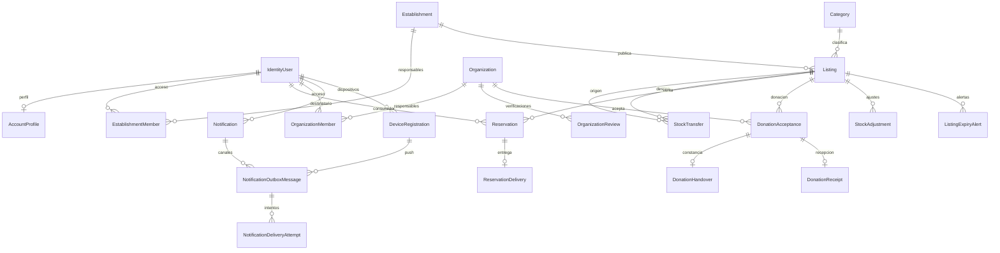

# Modelo de datos de XFood v1

Diseño basado en SRS, especificaciones y arquitectura v2.1 del 30/10/2026. Un backend, un `XFoodDbContext`, una base SQL Server; cada módulo conserva la propiedad de sus datos. Las entidades se encuentran en `src/XFood.Domain/Modules` y los mapeos en `src/XFood.Infrastructure/Modules`. Las referencias entre módulos son identificadores; las claves foráneas se definen en Infraestructura. Este cambio aporta datos y restricciones, no implementa casos de uso ni ejecuta trabajos.

Los tres documentos locales se sincronizaron como versión 2.1 con las decisiones aceptadas: catálogo controlado, principal obligatorio, cancelación antes del inicio para consumidor/organización, cancelación por establecimiento con motivo/aviso, incidencia parcial/tardía, solicitudes desde una unidad sin máximo universal, bandeja/push y alerta inicial configurable de dos horas. La lista del catálogo, resolución detallada de incidencias, proveedor push y retención siguen pendientes.

## Entidades por módulo

| Módulo / esquema | Entidades nuevas | Relaciones y datos principales |
| --- | --- | --- |
| Identidad / `identity` | `AccountProfile`, `AccountStatusChange` | Perfil 1:1 con `IdentityUser<Guid>`: nombre visible, estado y versión. Historial de suspensión/habilitación con actor, motivo y fecha. Identity conserva credenciales y roles. |
| Establecimientos / `establishments` | `Establishment`, `EstablishmentMember`, `EstablishmentStatusChange` | Contacto, dirección, latitud/longitud, zona horaria y estado. Membresías de usuarios con responsabilidad y fechas de concesión/revocación. Un establecimiento tiene muchas publicaciones. |
| Publicaciones / `listings` | `Listing`, `Category`, `StockAdjustment`, `StockTransfer`, `ListingStatusChange`, `ListingFitnessChange` | Catálogo obligatorio sin valores inventados, modalidad, precios, declaración y aptitud actual, condiciones de recogida, ventana, saldos e historial. Transferencias trazan origen/destino y autor sin contarse como pérdidas. |
| Reservas / `reservations` | `Reservation`, `ReservationStatusChange`, `ReservationDelivery` | Usuario consumidor, publicación de venta, cantidad y estado. Instantáneas de título, precio, dirección, condiciones, forma de pago, zona y ventana. Clave de idempotencia/hash y referencia de recogida. Como máximo una entrega completa por reserva. |
| Donaciones / `donations` | `Organization`, `OrganizationMember`, `OrganizationReview`, `DonationAcceptance`, `DonationAcceptanceStatusChange`, `DonationHandover`, `DonationReceipt` | Responsables e información de verificación; cada revisión conserva una instantánea de los datos revisados. La aceptación pertenece a una organización y a un lote de donación. Recepción completa por la organización y constancia opcional de entrega del establecimiento son registros distintos. |
| Notificaciones / `notifications` | `Notification`, `NotificationOutboxMessage`, `NotificationDeliveryAttempt`, `ListingExpiryAlert`, `DeviceRegistration` | Bandeja persistente y envío por dispositivo con estado, próximo intento y reclamo temporal. Una alerta por publicación/umbral; configuración inicial de 120 minutos. |
| Administración / `administration` | `Incident`, `IncidentStatusChange` | Autor, recurso relacionado opcional, encargado, estado y cierre; cada decisión conserva actor y motivo. Los reportes se derivan de operaciones e historial, sin tablas de totales redundantes. |



## Stock e indicadores

La publicación conserva `InitialQuantity`, `AddedQuantity`, `TransferredInQuantity`, `TransferredOutQuantity`, `AvailableQuantity`, `AssignedQuantity`, `FulfilledQuantity` y `WrittenOffQuantity`. El balance exigido por fila es:

```text
InitialQuantity + AddedQuantity + TransferredInQuantity
  = AvailableQuantity + AssignedQuantity + FulfilledQuantity + WrittenOffQuantity + TransferredOutQuantity
```

Los saldos no son un inventario empresarial: describen únicamente las unidades de ese lote publicado. Asignar mueve unidades disponibles a asignadas; cancelar a tiempo puede devolverlas; entregar/recibir mueve asignadas a cumplidas; una merma o un vencimiento mueve las unidades afectadas a retiradas. Los aumentos y pérdidas tienen un `StockAdjustment`; las asignaciones y cierres tienen su operación e historial. La igualdad de los contadores con los registros de otras tablas se preservará en los casos de uso mediante transacciones.

| Indicador | Fuente y fecha |
| --- | --- |
| Cantidad publicada | Cantidad inicial por fecha de creación; los aumentos se informan por separado desde ajustes `Increase`. |
| Pendiente | Reservas `Reserved` y aceptaciones `Accepted`; no equivalen a venta ni donación entregada. |
| Entregada en venta | Cantidad de reserva unida a `ReservationDelivery.DeliveredAtUtc`. El importe comprometido usa `UnitPrice`; no prueba pago recibido. |
| Donación recibida | Cantidad de aceptación unida a `DonationReceipt.ReceivedAtUtc`. Una `DonationHandover` por sí sola no acredita recepción. |
| No aprovechada | Suma de ajustes `Withdrawal` y `Expiry` por `OccurredAtUtc`. No volver a sumar cantidades de operaciones con estado `Expired`. |
| Verificación y administración | Revisiones, cambios de estado e incidencias por fecha, estado, actor y motivo. |

Los períodos usan inicio inclusivo y fin exclusivo. Un vencimiento debe registrar exactamente la pérdida de las unidades afectadas, incluida la parte aún no asignada, y no reintegrarlas automáticamente a una publicación vencida. La atribución de unidades físicas entre lotes de venta y donación separados sigue siendo responsabilidad del establecimiento y de sus casos de uso.

`StockTransfer` conserva origen y destino del mismo establecimiento, sus modalidades (iguales o distintas), cantidad, autor, motivo y fecha. La modalidad de cada lote permanece fija. La transacción futura debe comprobar que solo se trasladan unidades disponibles/no comprometidas y aptas, reducir disponibilidad y aumentar salida en origen, aumentar entrada y disponibilidad en destino, y guardar el registro una sola vez. Un destino creado íntegramente desde traslado puede tener cantidad inicial cero y entrada positiva; el traslado se informa separado para no contarlo como nuevo excedente ni como pérdida. Una merma real continúa usando `StockAdjustment`.

## Conservación de Identity y de los datos

`20261030065020_InitialIdentity` ya está aplicada según el responsable de la base. Sus archivos de migración y diseñador se conservan sin modificaciones. No se recrean usuarios, roles, credenciales ni tablas existentes. Los perfiles de aplicación complementan a Identity mediante una relación 1:1 y deberán crearse para las cuentas existentes con sus datos reales; esta migración no inventa nombres ni estados históricos.

Se incorpora un índice único filtrado sobre el correo normalizado de Identity. Si la base ya contiene correos normalizados repetidos, su creación fallará: se debe revisar la duplicación antes de aplicar, sin borrar cuentas automáticamente. Un correo nulo conserva la compatibilidad con las filas de Identity existentes; los futuros registros deben exigir correo y normalizarlo mediante Identity.

Las relaciones nuevas usan `NO ACTION` para evitar borrados en cascada de operaciones e historial, incluidas las referencias al usuario actor. Las cuentas y recursos se suspenden o desactivan, no se eliminan para ocultarlos. Esto no convierte las tablas de historial en inmutables frente a un administrador SQL: los casos de uso deben tratarlas como registros que solo se agregan y el despliegue debe limitar permisos de escritura. Retención y anonimización requieren una política del equipo.

## Restricciones y transacciones

Claves, obligatoriedad, unicidad, rangos, modalidad/precio, cantidades y relaciones se protegen en SQL según el mapeo. Las fechas representan instantes UTC; la zona de presentación se conserva por separado. Los importes tienen dos decimales y la moneda de v1 es DOP. Los límites de texto son tamaños técnicos propuestos para el esquema, no límites de producto aprobados.

`CHECK (AvailableQuantity >= 0)` evita guardar un saldo negativo; no impide que dos solicitudes lean el mismo saldo y creen dos asignaciones. `rowversion` permite detectar una actualización concurrente cuando EF actualiza la publicación con el valor leído, pero tampoco protege una inserción de reserva que omita actualizarla. Cada asignación deberá ejecutar en una sola transacción SQL: autorización y vigencia; actualización condicional de disponibilidad o actualización protegida por `rowversion`; creación de reserva/aceptación e idempotencia; historial; aviso/outbox; commit. Un conflicto debe revertir la operación completa. No se debe reintentar automáticamente una parte de esa transacción.

Cancelación, entrega, recepción, vencimiento y ajustes de unidades también deben coordinar sus cambios dentro de una transacción. Los casos de uso validarán rol, propiedad, organización aprobada, transiciones permitidas, cantidades acumuladas, inmutabilidad de las condiciones prometidas, correspondencia entre la referencia de idempotencia y el cuerpo, y existencia de la confirmación al cerrar la operación. Las restricciones que comparan varias filas no quedan resueltas por un `CHECK` local.

El consumidor o la organización pueden cancelar antes de `PickupStartsAtUtc`; el establecimiento puede cancelar con motivo y aviso a la contraparte. El actor y motivo quedan en el historial de la operación, y el aviso en la bandeja/outbox dentro de la misma transacción. El reintegro exige lote vigente, no desactivado y `IsFoodFit=true`. `FoodSafetyDeclared` conserva la declaración original; la aptitud actual puede cambiar y deja `ListingFitnessChange` con autor y motivo. Un saldo, una FK o un `CHECK` no verifican por sí solos esas condiciones temporales y permisos.

La confirmación normal sigue siendo completa. Una recogida parcial o tardía se conserva en `Incident` mediante `Kind`, `ActualQuantity` y `ObservedAtUtc`, referida a reserva o aceptación; no crea automáticamente una entrega/recepción completa ni suma toda su cantidad a indicadores de entregas. Comparar cantidad observada con cantidad comprometida, registrar el saldo pendiente y resolver la incidencia requiere un caso de uso y la política detallada aún pendiente. Las solicitudes ordinarias admiten desde una unidad hasta el disponible; no se añade máximo universal.

Las membresías `IsPrimary` tienen un índice filtrado que impide dos principales activos por establecimiento u organización. Cada entidad debe tener exactamente uno al confirmar su creación o una modificación de responsables. El futuro caso de uso creará padre y primera membresía principal en una sola transacción y comprobará exactamente uno antes de commit; si falla, revertirá ambos. En cambios posteriores serializará todas las mutaciones por padre mediante `UPDLOCK, HOLDLOCK`, o actualizará su `rowversion` en todas esas mutaciones y revertirá/reintentará la transacción completa ante conflicto. El relevo revocará la membresía anterior y añadirá la nueva conservando períodos y autores; no podrá confirmar la revocación del último sin sustituto. El cero intermedio dentro de la transacción no se confirma y evita una FK circular o un trigger que dificulte crear el padre. Las escrituras SQL directas siguen pudiendo violar la existencia: este protocolo todavía debe implementarse en los casos de uso. El catálogo `Category` admite desactivación e índice único de nombre; cada publicación necesita `CategoryId`, pero no se incluyen semillas porque sus valores iniciales están pendientes.

Los avisos se guardarán dentro de esa transacción y se enviarán después del commit. Un trabajador deberá reclamar el mensaje de forma atómica, respetar el vencimiento del reclamo y deduplicar reintentos. Tener columnas de reclamo y un índice único no implementa por sí mismo ese protocolo. Una caída del proveedor no revertirá stock ya comprometido.

Push conserva períodos de registro de dispositivos, plataforma, proveedor, instalación, hash del token y token protegido. El futuro adaptador debe cifrarlo antes de persistir; el modelo no implementa cifrado ni un proveedor. El outbox permite un trabajo por notificación/dispositivo y exige por FK compuesta que el dispositivo pertenezca al destinatario. La revocación preserva historial y debe excluirse del despacho. `Notifications:ExpiryAlerts:ThresholdMinutes` tiene valor inicial configurable 120, validado positivo al iniciar; el trabajador aún no existe. La bandeja permanece disponible aunque falle push.

## Supuestos que debe validar el equipo

- Cada establecimiento y organización tiene un principal activo y puede tener otros responsables; los permisos detallados para conceder y revocar acceso siguen pendientes. La creación y el relevo deben seguir el protocolo transaccional documentado.
- La resolución de incidencias parciales o tardías y sus efectos sobre stock e indicadores sigue pendiente; el modelo conserva hechos sin fingir una entrega completa.
- El catálogo inicial de categorías queda pendiente de aprobación; la relación controlada ya es obligatoria.
- La modalidad es inmutable una vez persistido el lote: forma parte de la clave alternativa usada para impedir reservas de donaciones y aceptaciones de ventas. Cambiarla requiere cerrar y crear otro lote.
- Las claves de idempotencia distinguen mayúsculas y no admiten espacios iniciales o finales. Cada operación conserva el SHA-256 del cuerpo como 64 caracteres hexadecimales en mayúsculas; el futuro caso de uso definirá la representación canónica antes de calcularlo.
- El radio y el proveedor push siguen pendientes. La cancelación de consumidor/organización queda limitada a antes del inicio; no existe máximo universal inicial y la alerta comienza con 120 minutos configurables.
- La evidencia requerida para verificar organizaciones, sus plazos de conservación y la política de anonimización siguen pendientes.
- Los índices iniciales responden a estados, fechas, propietarios e idempotencia. Su rendimiento debe medirse con carga y datos representativos.
- El esquema de sesión/token para Flutter y Next.js, los roles habilitados y las comprobaciones de suspensión deben configurarse al implementar autenticación.

## Aplicación posterior a XFoodDB

La migración de negocio `AddV1DataModel` se regenera para contener el modelo completo ajustado. Su generación anterior no se había aplicado y fue retirada sin `force`, tras comprobar el historial. El [script SQL de avance](sql/AddV1DataModel.sql) cubre el tramo desde `InitialIdentity`; los archivos C#, diseñador y snapshot también quedan versionables. Las tablas existentes de Identity se conservan y únicamente reciben el índice de correo.

La migración de negocio no se ha aplicado a `XFoodDB`. La consulta de solo lectura de `DB_NAME()` y `__EFMigrationsHistory` confirmó allí únicamente `20261030065020_InitialIdentity` aplicada. La retirada de archivos de negocio comprobó otra vez ese historial y no ejecutó cambios de esquema ni reversión de esa base. La aplicación posterior para validación se realizó exclusivamente en la base nueva y aislada identificada en las verificaciones.

Antes de aplicar, el responsable puede ejecutar estas consultas de solo lectura en la conexión local seleccionada para revisar destino, historial y duplicados:

```sql
SELECT DB_NAME() AS BaseActual;
SELECT MigrationId FROM dbo.__EFMigrationsHistory ORDER BY MigrationId;
SELECT NormalizedEmail, COUNT_BIG(*) AS Repeticiones
FROM [identity].[Users]
WHERE NormalizedEmail IS NOT NULL
GROUP BY NormalizedEmail
HAVING COUNT_BIG(*) > 1;
```

No debe modificarse ni eliminarse el historial de migraciones para resolver un conflicto. El script SQL de avance se entrega para revisión, no se aplica automáticamente. La reversión `Down` elimina las tablas nuevas y perdería los datos almacenados en ellas; no debe usarse para deshacer una migración que ya contenga operaciones reales sin un plan de respaldo y restauración.

Después de revisar y aprobar el diseño, desde la carpeta que contiene `XFood.slnx`, con User Secrets apuntando a `XFoodDB` y sin una variable de entorno que sobrescriba esa conexión:

```powershell
$env:ASPNETCORE_ENVIRONMENT='Development'
dotnet tool run dotnet-ef database update AddV1DataModel --project src/XFood.Infrastructure --startup-project src/XFood.Api --context XFoodDbContext
```

## Verificaciones realizadas

Resultado final de esta integración: migración `20261030234244_AddV1DataModel`, con 28 tablas, 88 índices, 149 restricciones CHECK y 63 claves foráneas nuevas. Su avance solo crea esquemas, tablas e índices; no elimina ni modifica datos existentes. La compilación pasó con cero advertencias/errores y las 24 pruebas pasaron. El modelo coincide con el snapshot. El SQL idempotente está en `docs/sql/AddV1DataModel.sql`. La migración de negocio anterior, confirmada como no aplicada mediante historial de solo lectura, fue regenerada; InitialIdentity y su diseñador mantienen sus SHA-256 originales.

`dotnet restore XFood.slnx` pasó; `dotnet build XFood.slnx --no-restore` terminó con cero advertencias y cero errores; `dotnet test XFood.slnx --no-build` pasó 24 pruebas. Las pruebas verifican tokens de concurrencia, precisión, claves de idempotencia/deduplicación, unicidad de entregas, relaciones de modalidad, conservación del índice de correo original, operaciones aditivas de la nueva migración y ausencia de dependencias de frameworks en Dominio. `migrations has-pending-model-changes` confirmó que el snapshot coincide con el modelo. Los SHA-256 de la migración original y de su diseñador coinciden con la evidencia anterior al cambio.

Las 24 pruebas anteriores inspeccionan el modelo y las operaciones de migración sin conectarse a SQL Server. Además, se aplicaron ambas migraciones mediante una validación real en la base nueva y aislada `XFood_Validation_20261030_234635_2179f174`, distinta de `XFoodDB`. Allí se confirmaron 35 tablas de aplicación (7 de Identity y 28 de negocio), las 149 restricciones CHECK habilitadas y confiables, las claves foráneas confiables y el catálogo sin semillas.

En esa base aislada se ejecutaron inserciones válidas de usuarios, establecimiento, organización, principales, categoría y publicación. Se comprobó que SQL Server rechaza cantidad negativa, categoría inexistente, precio en donación y principales activos duplicados tanto en establecimiento como en organización. También se comprobó el relevo del principal y la reversión completa de la transacción. Los datos de prueba se revirtieron mediante rollback. No se aplicó la migración de negocio a `XFoodDB`.

Esta validación confirma la creación del esquema y las restricciones ejercitadas. No acredita por sí sola los futuros casos de uso ni su concurrencia: la asignación simultánea de últimas unidades y la obligación transaccional de no confirmar una entidad sin principal todavía deberán probarse sobre sus implementaciones.

## Referencias técnicas

El protocolo de concurrencia se apoya en [la documentación de EF Core sobre tokens de concurrencia](https://learn.microsoft.com/en-us/ef/core/saving/concurrency). La coherencia del snapshot se comprueba con [HasPendingModelChanges](https://learn.microsoft.com/en-us/ef/core/managing-schemas/migrations/managing#checking-for-pending-model-changes). Esas comprobaciones de metadatos no sustituyen las pruebas con SQL Server de asignación simultánea a la última unidad.
